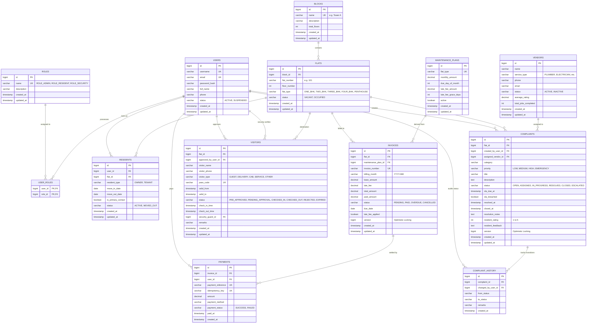

# SocietyOS - Entity Relationship Diagram (ERD)

This document visualizes the complete database schema for **SocietyOS**, an apartment and gated-community management system.

## Mermaid ER Diagram

## Relational Constraints & Invariants

1. **Idempotent Billing (`uk_invoices_flat_billing_month`)**:
   - `UNIQUE(flat_id, billing_month)` ensures the monthly billing cron job cannot accidentally generate multiple invoices for the same flat in the same billing cycle.
2. **Idempotent Payments (`uk_payments_idempotency_key`)**:
   - `UNIQUE(idempotency_key)` protects against double charges due to retried network requests.
3. **Flat Uniqueness (`uk_flats_block_number`)**:
   - `UNIQUE(block_id, flat_number)` guarantees flat numbers are unique within each block/tower.
4. **Optimistic Locking (`version`)**:
   - Used on `invoices` and `complaints` to prevent race conditions during concurrent updates (e.g. paying an invoice or multiple admins updating a ticket simultaneously).

